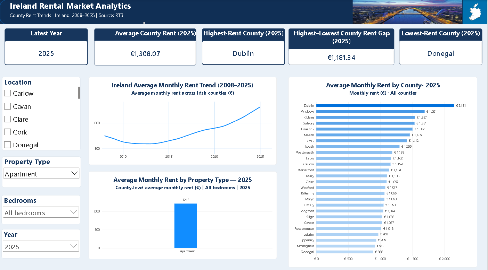

# Ireland Rental Market Analytics

## Project Overview

An interactive Power BI dashboard exploring Ireland's rental market trends from 2008 to 2025. The project compares average monthly rents across counties and property types to identify rental patterns and regional differences.

## Dashboard Preview

## Tools Used

- **Power BI Desktop** — Dashboard development and visualization
- **Power Query** — Data cleaning and transformation
- **DAX** — Measures and calculations

## Dashboard Features

- **Key Performance Indicators:** Latest year, average county rent, highest-rent county, lowest-rent county, and rent gap.
- **Rental Trend Analysis:** Explore average monthly rent trends from 2008 to 2025.
- **County Comparison:** Compare average monthly rents across Irish counties.
- **Property-Type Analysis:** Compare rental values across property types.
- **Interactive Filters:** Explore the data by location, property type, bedrooms, and year.

## Data and Methodology

The analysis covers rental data from 2008 to 2025. Power Query was used to prepare the dataset, while DAX measures were used to calculate rental averages and compare counties.

Missing rent values are treated as unavailable observations rather than zero rents.

## Key Questions

- How have average rents changed over time?
- Which counties have the highest and lowest average rents?
- How does rent vary by property type?
- How large is the gap between the highest- and lowest-rent counties?

## Data Source

**Dataset:** RIA02 — RTB Average Monthly Rent Report  
**Publisher:** Central Statistics Office (CSO), Ireland  
**Data owner:** Residential Tenancies Board (RTB)

The project analyses annual average monthly rent data segmented by location, property type, and number of bedrooms.

**Official dataset:** https://data.gov.ie/dataset/ria02-rtb-average-monthly-rent-report

## Author

Vikas Rathod

*Portfolio project demonstrating data preparation, DAX calculations, and interactive dashboard development in Power BI.*
